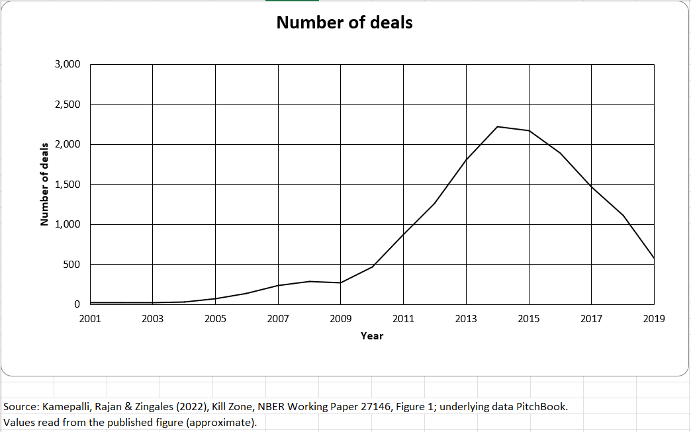
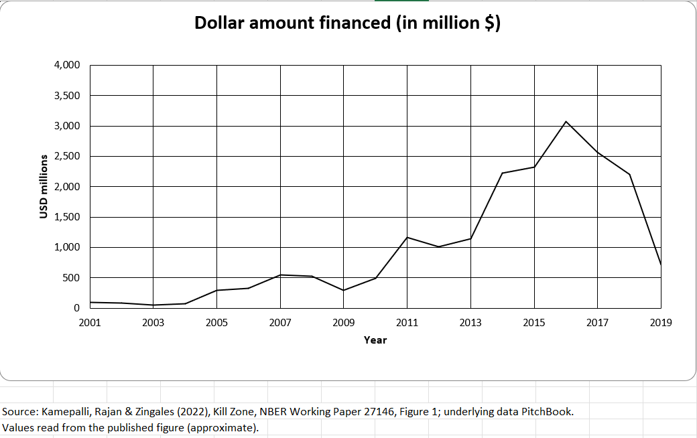

# Kill Zone, Figure 1 (recreated)

Charts `Fig1a` and `Fig1b` from
[`capabilities/economic-research/model.xlsx`](../../capabilities/economic-research/model.xlsx),
built per [`spec.md`](../../capabilities/economic-research/spec.md) from
[`data/kill-zone.md`](../../data/kill-zone.md). Each image is the chart saved
as a picture from Excel.

## Figure 1a: Number of deals, 2001–2019

## Figure 1b: Dollar amount financed (in million $), 2001–2019

Source: Kamepalli, Rajan & Zingales (2022), *Kill Zone*, NBER Working Paper
27146, Figure 1; underlying data PitchBook. Values read from the published
figure (approximate).
